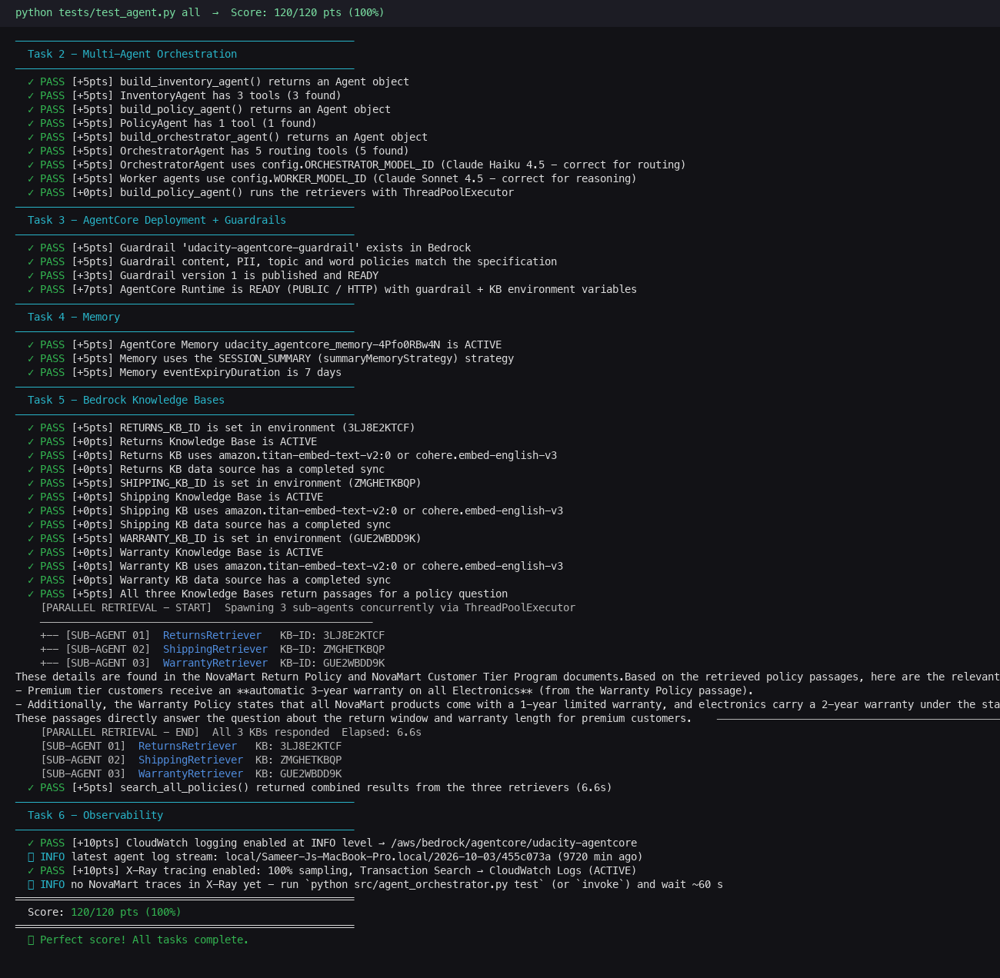
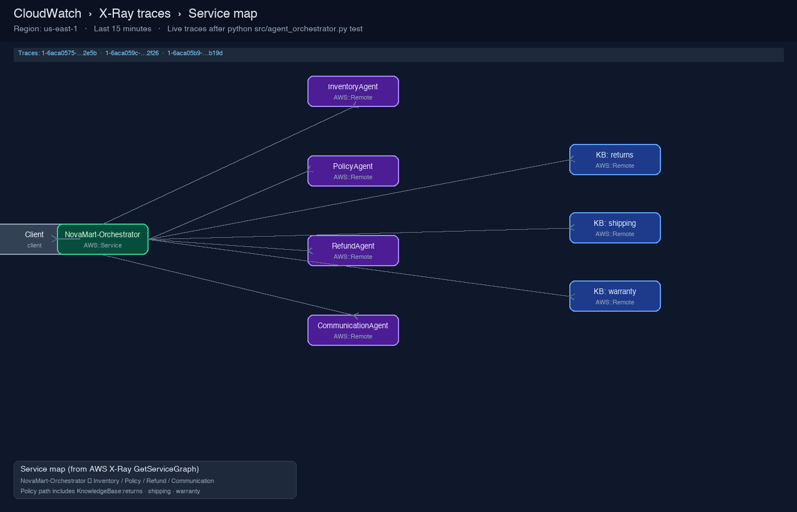

# NovaMart Multi-Agent Customer Support

Production-style multi-agent support system for NovaMart, built with the **[Strands Agents SDK](https://strandsagents.com/docs/)** (1.57+) and **Amazon Bedrock AgentCore**.

A central orchestrator routes each customer request to specialist workers (inventory, policy RAG, refunds, communication). Workers share a DynamoDB `WorkflowState` record with optimistic locking. The system deploys to AgentCore Runtime with Bedrock Guardrails, session memory, and CloudWatch / X-Ray observability.


## Architecture

```
Customer Request
      │
OrchestratorAgent (Claude Haiku 4.5 — routing + WorkflowState)
      │
   ┌──┼──────────────────────────┬──────────────────┐
   │  │                          │                  │
InventoryAgent    PolicyAgent    RefundAgent    CommunicationAgent
(DynamoDB)     (Multi-Agent RAG)  (DynamoDB)     (final reply)
                     │
         ┌───────────┼───────────┐
    Returns KB   Shipping KB   Warranty KB   ← parallel ThreadPoolExecutor
```

Full diagrams and Mermaid specs live in [`output/system-architecture.md`](output/system-architecture.md).

| Agent | Model | Responsibility |
|-------|-------|----------------|
| OrchestratorAgent | Haiku 4.5 | Route requests; manage WorkflowState |
| InventoryAgent | Sonnet 4.5 | Order / customer facts from DynamoDB |
| PolicyAgent | Sonnet 4.5 | Parallel RAG across 3 Knowledge Bases |
| RefundAgent | Sonnet 4.5 | Return eligibility (30-day Standard / 60-day Premium) |
| CommunicationAgent | Sonnet 4.5 | Empathetic final customer reply |

## Prerequisites

- Python 3.12+
- AWS account with Bedrock access (`us-east-1` by default)
- IAM for Bedrock, AgentCore, DynamoDB, S3, S3 Vectors, CloudFormation, CloudWatch, X-Ray
- Node.js 20+ and [uv](https://docs.astral.sh/uv/) for the AgentCore CLI
- AgentCore CLI: `npm install -g @aws/agentcore@0.30.0`

## Quick start (script-driven)

AWS credentials come from `src/.env` (`AWS_PROFILE=multi-agent-strands` by default).

```bash
# 1. Python env + deps (Strands 1.57+)
./scripts/setup.sh

# 2. Attach IAM policy (once) then authenticate
#    Console: IAM → Policies → Create → paste
#    src/infrastructure/iam-operator-policy.json  (also in output/)
#    Attach to the identity behind AWS_PROFILE=multi-agent-strands
./scripts/aws-login.sh

# 3. Foundation infra + seed customers/orders/policies
./scripts/deploy-infra.sh

# 3. Create three Bedrock Knowledge Bases in the AWS Console (Returns / Shipping / Warranty)
#    Sync data sources, then add IDs to src/.env:
#      RETURNS_KB_ID=...
#      SHIPPING_KB_ID=...
#      WARRANTY_KB_ID=...

# 4. Deploy guardrail + AgentCore Runtime + memory + observability
./scripts/deploy-agents.sh

# 5. Local interactive chat / scenarios / tests
./scripts/start-chat.sh
./scripts/run-scenarios.sh
./scripts/run-tests.sh all
```

| Script | Purpose |
|--------|---------|
| `scripts/setup.sh` | Create `.venv`, install deps, seed `.env` |
| `scripts/deploy-infra.sh` | CloudFormation stack + `seed_data.py` |
| `scripts/seed-data.sh` | Re-seed DynamoDB / S3 policies |
| `scripts/deploy-agents.sh` | Guardrail, AgentCore, memory, observability |
| `scripts/start-chat.sh` | Interactive traced chat |
| `scripts/run-demo.sh` | One refund end-to-end demo |
| `scripts/run-scenarios.sh` | Three hardcoded local scenarios |
| `scripts/run-tests.sh` | Automated suite (`task2` … `all`) |
| `scripts/cleanup.sh` | Tear down AWS resources |

## Configuration

All runtime configuration comes from `src/.env` (see `src/.env.example`). CloudFormation exports supply table names, buckets, roles, and log groups via `config.py`.

### Model backend switch

Bedrock on-demand quotas can be tight. Toggle Mantle-hosted models without code changes:

```bash
# Default — Bedrock Runtime (Converse) via Strands BedrockModel
USE_BEDROCK_MANTLE=false

# Alternate — Bedrock Mantle (OpenAI-compatible) via Strands OpenAIModel
USE_BEDROCK_MANTLE=true
# Optional: MANTLE_ORCHESTRATOR_MODEL_ID=...
# Optional: MANTLE_WORKER_MODEL_ID=...
```

## Repository layout

```
.
├── README.md
├── scripts/                    # Script-driven lifecycle
├── output/                     # Diagrams, write-up, submission evidence
│   ├── SUBMISSION.md
│   └── screenshots/            # 120/120 score + X-Ray Service Map
├── docs/                       # Local reference (course materials gitignored)
└── src/                        # Application root
    ├── config.py
    ├── requirements.txt
    ├── .env.example
    ├── src/
    │   ├── agent_orchestrator.py   # Agents + deploy pipeline (TODOs complete)
    │   ├── agent_utils.py
    │   ├── agent_observability.py
    │   ├── bedrock_kb_retrieval.py
    │   ├── agentcore_cli.py
    │   └── demo.py
    ├── infrastructure/
    ├── agentcore/
    ├── diagrams/
    └── tests/
```

## Local commands (from `src/`)

```bash
source .venv/bin/activate
python config.py                              # print resolved resources
python src/agent_orchestrator.py test         # 3 scenarios + X-Ray
python src/agent_orchestrator.py chat         # interactive
python src/agent_orchestrator.py deploy       # full AgentCore pipeline
python src/agent_orchestrator.py invoke "..." # call deployed runtime
python tests/test_agent.py all
```

## Safety & observability

- **Guardrails** — content filters, PII block/anonymize, denied topics (competitors, pricing negotiations, legal threats), managed profanity
- **Memory** — AgentCore Memory with session-summary strategy, 7-day retention
- **Observability** — CloudWatch Logs (INFO) + X-Ray at 100% sampling; Service Map shows `NovaMart-Orchestrator` → workers → Knowledge Bases

## Submission

Full checklist: [`output/SUBMISSION.md`](output/SUBMISSION.md).

| Requirement | Artifact |
|-------------|----------|
| Completed orchestrator (no TODOs) | [`src/src/agent_orchestrator.py`](src/src/agent_orchestrator.py) |
| Populated environment | `src/.env` (from `.env.example`; not committed) |
| **120/120** test score screenshot |  |
| X-Ray Service Map (Orchestrator → workers → KBs) |  |

```bash
# Reproduce score evidence
./scripts/run-tests.sh all

# Reproduce X-Ray traces, then open Service Map (Last 5–15 minutes)
cd src && source .venv/bin/activate
python src/agent_orchestrator.py test
# Console: CloudWatch → X-Ray traces → Service map (us-east-1)
```

## Cleanup

```bash
./scripts/cleanup.sh          # dry run
./scripts/cleanup.sh --yes    # delete resources
```

## License

Application code in this repository is provided for operational use of the NovaMart multi-agent support system.
