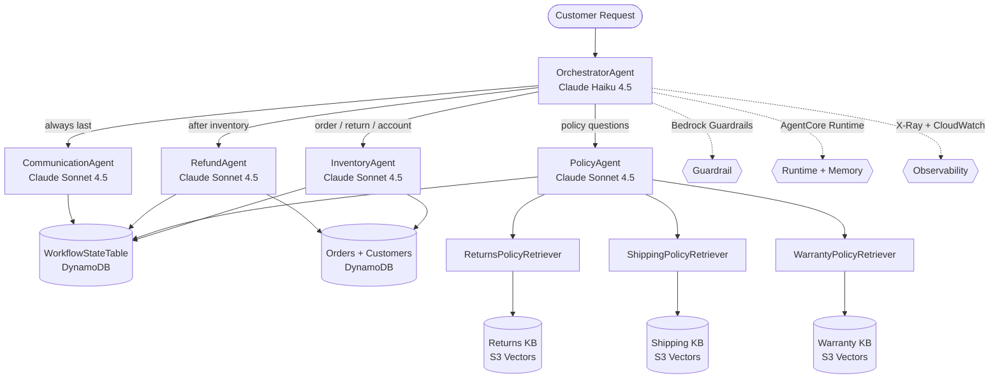
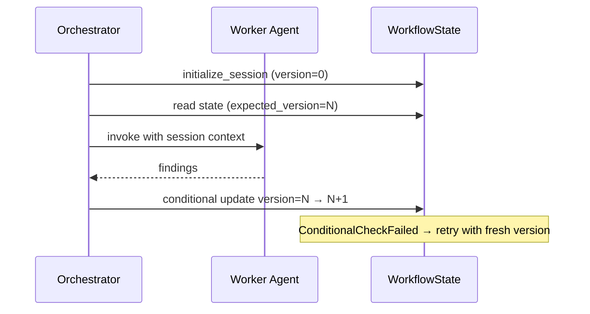

# NovaMart Multi-Agent Support — System Architecture

## Overview

NovaMart’s customer support AI layer uses an **Orchestrator → Workers** pattern built with the [Strands Agents SDK](https://strandsagents.com/docs/) (v1.57+) and Amazon Bedrock AgentCore.

A central **OrchestratorAgent** (Claude Haiku) routes each request to specialist workers. Workers write findings into a shared DynamoDB **WorkflowState** record with optimistic locking. The **CommunicationAgent** always composes the final customer-facing reply.

## Component Diagram

## Request Flows

| Scenario | Routing |
|----------|---------|
| Return / refund / order status | `initialize_session` → Inventory → Refund → Communication |
| Policy meaning (windows, rates, warranty) | `initialize_session` → Policy (3 parallel KB retrievers) → Communication |
| Account tier questions | `initialize_session` → Inventory → Communication |
| Math / pricing calculations | `initialize_session` → Communication only |

## Shared State (Optimistic Locking)

## Model Backends

| `.env` switch | Provider | Strands class |
|---------------|----------|---------------|
| `USE_BEDROCK_MANTLE=false` (default) | `bedrock-runtime` Converse API | `BedrockModel` |
| `USE_BEDROCK_MANTLE=true` | `bedrock-mantle` OpenAI-compatible | `OpenAIModel` + `bedrock_mantle_config` |

## Deployment Topology

1. **CloudFormation** (`infrastructure/starter_stack.yaml`) — DynamoDB, S3, S3 Vectors indexes, IAM role, log group  
2. **Bedrock Knowledge Bases** (console) — Returns / Shipping / Warranty synced to S3 Vectors  
3. **AgentCore CLI** — packages `build/runtime/` and deploys HTTP runtime  
4. **Guardrail + Memory + Observability** — created/configured by `agent_orchestrator.py deploy`

## Key Modules

| Path | Role |
|------|------|
| `src/src/agent_orchestrator.py` | Agent builders, routing tools, deploy pipeline |
| `src/src/bedrock_kb_retrieval.py` | KB retrieve helper for PolicyAgent |
| `src/src/agent_observability.py` | X-Ray + CloudWatch tooling |
| `src/config.py` | Lazy CloudFormation exports + `.env` |
| `scripts/` | Script-driven setup, deploy, test, cleanup |
